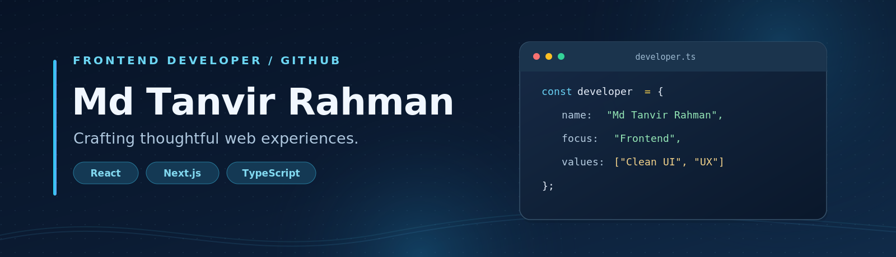

  

  <h1>Hi, I'm Md Tanvir Rahman 👋</h1>
  <h3>Frontend Developer | React • Next.js • TypeScript</h3>

  
I build responsive, accessible, and user-friendly web applications with a focus on clean interfaces and thoughtful user experiences.

  
  
  

---

## 👨‍💻 About Me

I'm a frontend developer from **Bangladesh** who enjoys turning ideas into practical, polished web applications. I mainly work with **React, Next.js, JavaScript, TypeScript, and Tailwind CSS**, and I also use backend and authentication tools when a project calls for them.

I care about reusable components, responsive layouts, clear user flows, and building things that people can actually use.

### 🚀 What I'm Working On

- 🛒 Building and improving **[BazarDor](https://github.com/TanvirRahman888/bazar-dor)**, a market-price discovery application powered by Next.js.
- 🔐 Practicing authentication workflows with **Better Auth, MongoDB, Google, and GitHub sign-in**.
- 🧩 Strengthening my **TypeScript, Next.js App Router, component architecture, and API integration** skills.
- 🎨 Exploring better approaches to **responsive design, accessibility, and frontend performance**.
- 🤝 Open to collaborating on frontend projects and learning from other developers.

---

## 🧰 Technologies & Tools

**Languages and frontend**

  

**Backend, databases, and authentication**

  
  

**UI libraries and developer tools**

  
  
  

---

## 🌟 Featured Projects

<table>
  <tr>
    <td width="50%" valign="top">
      <h3>🛒 BazarDor</h3>
      
A Bangladesh-focused market-price web app with categorized products, price comparisons, sorting, product details, and user authentication.

      
<strong>Stack:</strong> Next.js, TypeScript, Tailwind CSS, HeroUI, Better Auth, MongoDB

      
<a href="https://github.com/TanvirRahman888/bazar-dor">Source Code</a> · <a href="https://bazar-dor-virid-beta.vercel.app/">Live Demo</a>

    </td>
    <td width="50%" valign="top">
      <h3>🧱 DevStack</h3>
      
An interactive technology explorer where users can discover developer tools, create a personal stack, and manage their selections.

      
<strong>Stack:</strong> React, TypeScript, Vite, Tailwind CSS, React Toastify

      
<a href="https://github.com/TanvirRahman888/DevStack">Source Code</a> · <a href="https://dev-stack-opal.vercel.app/">Live Demo</a>

    </td>
  </tr>
  <tr>
    <td width="50%" valign="top">
      <h3>🏋️ Fit Log</h3>
      
A workout tracker with exercise details, daily plans, saved workouts, search and sorting, completion tracking, and persistent browser storage.

      
<strong>Stack:</strong> Next.js, TypeScript, DaisyUI, Context API, Local Storage

      
<a href="https://github.com/TanvirRahman888/fit-log">Source Code</a>

    </td>
    <td width="50%" valign="top">
      <h3>💼 More Projects</h3>
      
Explore additional experiments and applications, including authentication exercises, full-stack projects, and frontend UI builds.

      
<strong>Focus:</strong> Learning by building and improving real project workflows.

      
<a href="https://github.com/TanvirRahman888?tab=repositories">Explore Repositories</a> · <a href="https://www.mdtanvirrahman.com/">Portfolio</a>

    </td>
  </tr>
</table>

---
## 📈 GitHub Activity

  
  

  

## 📈 GitHub Activity

  
  

  

> GitHub statistics are generated by third-party services and may load slowly or occasionally be unavailable. Language percentages describe repository code, not proficiency.

---

## 🤝 Let's Connect

I'm interested in frontend development, React/Next.js projects, UI engineering, and opportunities to build useful products. Feel free to reach out about a project, collaboration, or a role.

  
  
  
  

  Thanks for visiting. Take a look at my projects and feel free to connect!

